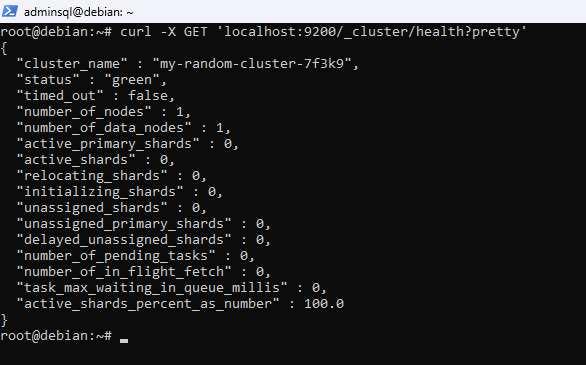
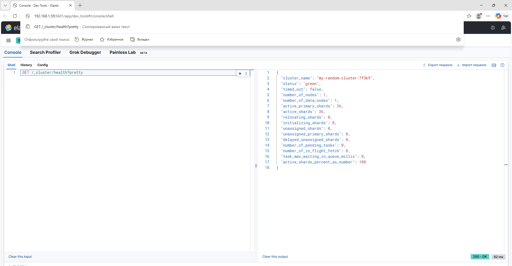
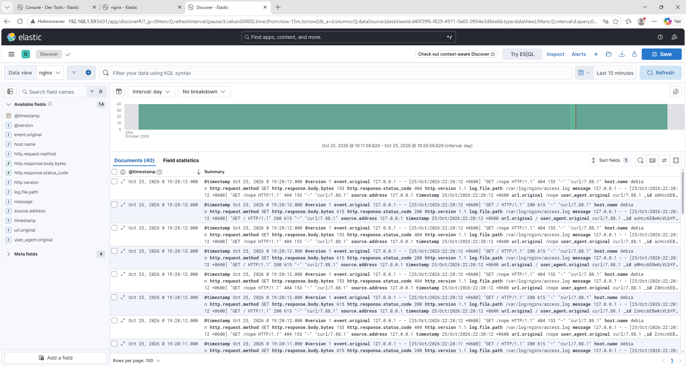
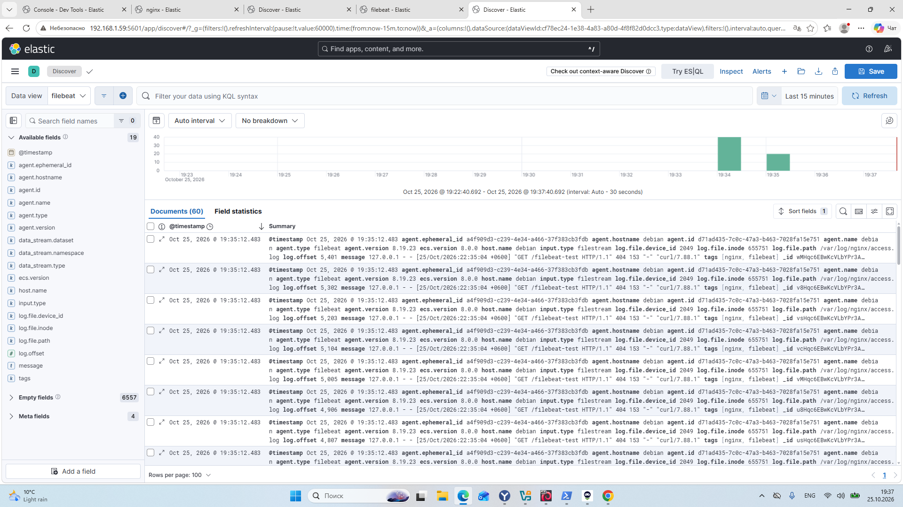

# Домашнее задание к занятию «ELK»

---

## Задание 1. Elasticsearch

> Установите и запустите Elasticsearch, после чего поменяйте параметр cluster_name на случайный.
> Приведите скриншот команды `curl -X GET 'localhost:9200/_cluster/health?pretty'`, сделанной на сервере с установленным Elasticsearch, где будет виден нестандартный cluster_name.

### Решение

```bash
apt install -y elasticsearch
```

`/etc/elasticsearch/elasticsearch.yml`:

```yaml
cluster.name: my-random-cluster-7f3k9
node.name: node-1
path.data: /var/lib/elasticsearch
path.logs: /var/log/elasticsearch
network.host: localhost
http.port: 9200
discovery.type: single-node
xpack.security.enabled: false
xpack.security.enrollment.enabled: false
xpack.security.http.ssl.enabled: false
xpack.security.transport.ssl.enabled: false
```

```bash
systemctl daemon-reload
systemctl enable --now elasticsearch
curl -X GET 'localhost:9200/_cluster/health?pretty'
```


### Скриншот



---

## Задание 2. Kibana

> Установите и запустите Kibana.
> Приведите скриншот интерфейса Kibana на странице `http://<ip вашего сервера>:5601/app/dev_tools#/console`, где будет выполнен запрос `GET /_cluster/health?pretty`.

### Решение

```bash
apt install -y kibana
```

`/etc/kibana/kibana.yml`:

```yaml
server.port: 5601
server.host: "0.0.0.0"
elasticsearch.hosts: ["http://localhost:9200"]
```

```bash
echo '--max-old-space-size=512' >> /etc/kibana/node.options
systemctl enable --now kibana
```

В Dev Tools → Console выполнен запрос:

```
GET /_cluster/health?pretty
```

### Скриншот



---

## Задание 3. Logstash

> Установите и запустите Logstash и Nginx. С помощью Logstash отправьте access-лог Nginx в Elasticsearch.
> Приведите скриншот интерфейса Kibana, на котором видны логи Nginx.

### Решение

```bash
apt install -y nginx logstash
systemctl enable --now nginx

# доступ к логам Nginx
usermod -aG adm logstash
```

`/etc/logstash/conf.d/nginx.conf`:

```
input {
  file {
    path => "/var/log/nginx/access.log"
    start_position => "beginning"
    sincedb_path => "/var/lib/logstash/sincedb_nginx"
  }
}

filter {
  grok { match => { "message" => "%{COMBINEDAPACHELOG}" } }
  date { match => [ "timestamp", "dd/MMM/yyyy:HH:mm:ss Z" ] }
}

output {
  elasticsearch {
    hosts => ["http://localhost:9200"]
    index => "nginx-access-%{+YYYY.MM.dd}"
  }
}
```

```bash
systemctl enable --now logstash

# генерация записей в access-логе
for i in $(seq 1 20); do curl -s localhost >/dev/null; curl -s localhost/nope >/dev/null; done
curl 'localhost:9200/_cat/indices/nginx*?v'
```

В Kibana создан Data View `nginx` (index pattern `nginx-access-*`, time field `@timestamp`), логи просмотрены в Discover.

### Скриншот



---

## Задание 4. Filebeat

> Установите и запустите Filebeat. Переключите поставку логов Nginx с Logstash на Filebeat.
> Приведите скриншот интерфейса Kibana, на котором видны логи Nginx, которые были отправлены через Filebeat.

### Решение

```bash
# отключаем поставку через Logstash
systemctl disable --now logstash

apt install -y filebeat
```

`/etc/filebeat/filebeat.yml`:

```yaml
filebeat.inputs:
  - type: filestream
    id: nginx-access
    enabled: true
    paths:
      - /var/log/nginx/access.log
    tags: ["nginx", "filebeat"]

output.elasticsearch:
  hosts: ["http://localhost:9200"]

setup.kibana:
  host: "http://localhost:5601"
```

```bash
filebeat test config
filebeat test output
systemctl enable --now filebeat

# новые записи для проверки
for i in $(seq 1 20); do curl -s localhost/filebeat-test >/dev/null; done
curl 'localhost:9200/_cat/indices/.ds-filebeat*?v'
```

В Kibana создан Data View `filebeat` (index pattern `filebeat-*`, time field `@timestamp`).

### Скриншот


